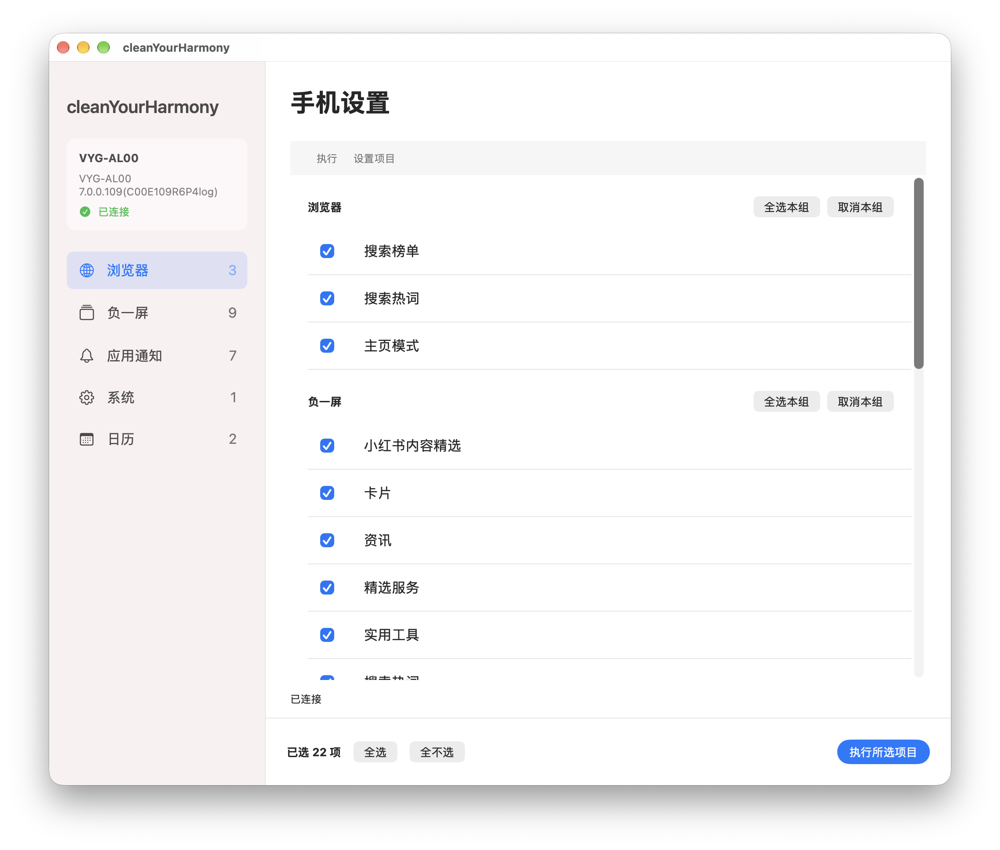
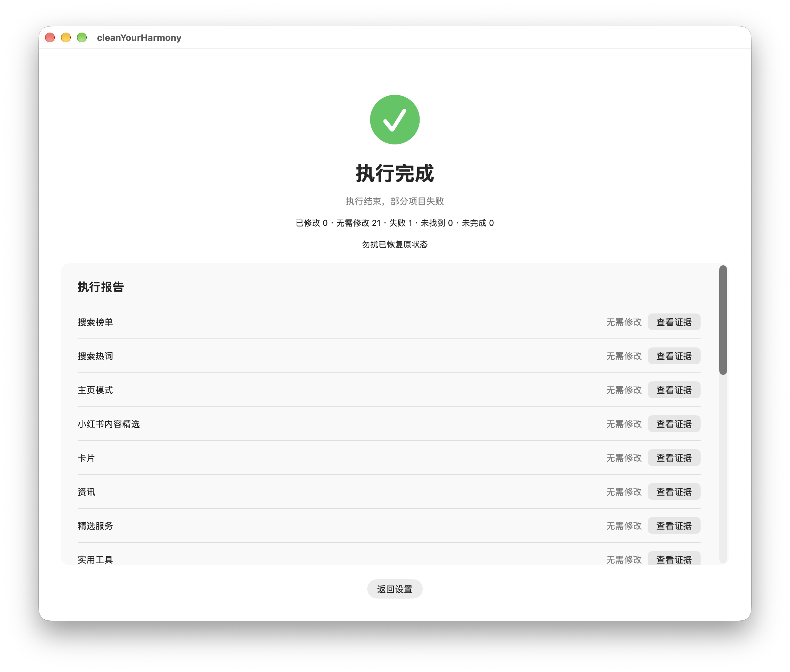

<div align="center">

# cleanYourHarmony

**A cleaner HarmonyOS phone · Native GUI & Agent CLI**

Reduce recommendations, feeds, and interruptions. Verify each result and keep evidence locally.

[Download GUI](https://github.com/MusherM/cleanYourHarmony/releases/latest) · [Use CLI](#cli) · [Operation catalog](operations.json) · [Report an issue](https://github.com/MusherM/cleanYourHarmony/issues)

中文：[README.md](README.md)

</div>

---

One operation catalog, one execution core, two ways to use it. The current catalog covers **22 settings in 5 categories**. Settings already at their targets are left unchanged; each result includes a status and device evidence.

| Interface | Best for | Getting started |
| --- | --- | --- |
| **Desktop GUI** | Selecting settings and reviewing results visually | Download the macOS / Windows installer; no agent setup required |
| **CLI + Agent** | Terminal workflows, environment setup, and exception handling | Give the repository URL and prompt below to an agent with computer access |

## Desktop GUI

Native macOS (SwiftUI) and Windows (WinUI 3) interfaces organize settings into Browser, leftmost home screen, app notifications, System, and Calendar. Select the operations you want, click the execute button, and follow progress and individual results. Unselected settings remain unchanged.





- **Ready to run**: installers bundle Node.js, hdc, and runtime dependencies. Normal execution needs no agent, model, or network.
- **Inspectable results**: distinguish changed, already satisfied, failed, not found, and incomplete items, with links to device evidence.
- **Stop and resume**: stopping finishes necessary verification and attempts Do Not Disturb restoration; interrupted tasks resume from progress. Stopping does not undo completed settings.

### Download and install

**[Get the GUI from Releases →](https://github.com/MusherM/cleanYourHarmony/releases/latest)** · Current version [v1.4.1](https://github.com/MusherM/cleanYourHarmony/releases/tag/v1.4.1)

| Platform | Installer | Installation |
| --- | --- | --- |
| macOS 13.5+ · Apple Silicon | [Download DMG](https://github.com/MusherM/cleanYourHarmony/releases/download/v1.4.1/cleanYourHarmony-1.4.1-macos-arm64.dmg) | Open and drag into Applications |
| macOS 13.5+ · Intel | [Download DMG](https://github.com/MusherM/cleanYourHarmony/releases/download/v1.4.1/cleanYourHarmony-1.4.1-macos-x64.dmg) | Open and drag into Applications |
| Windows 11 · x64 | [Download Setup](https://github.com/MusherM/cleanYourHarmony/releases/download/v1.4.1/cleanYourHarmony-1.4.1-windows-x64-Setup.exe) | Run the installer |

macOS packages are ad-hoc signed and not notarized; Windows packages are unsigned. Your operating system may show security prompts. Releases include SHA-256 checksums and matching source. Desktop source and build instructions are on the [desktop-app branch](https://github.com/MusherM/cleanYourHarmony/tree/desktop-app).

Connect the unlocked phone with a USB data cable, enable USB debugging, and authorize the computer on the phone. Then select settings and execute. See “When no phone is detected” below for connection help.

## What changes

| Category | Default targets |
| --- | --- |
| Browser · 3 items | Use the simple homepage; disable search rankings and trending terms |
| Leftmost home screen · 9 items | Disable listed recommendation modules, search suggestions, marketing notifications, and content subscriptions |
| App notifications · 7 items | Disable system notifications for Browser, Themes, AppGallery, Game Center, Video, Music, and Reading |
| System · 1 item | Attempt to leave the user experience improvement program; report failure if the system prevents changes |
| Calendar · 2 items | Disable recommended subscriptions; start the week on Monday |

See [operations.json](operations.json) for exact targets and exclusions. The tool does not delete browsing history, cancel services, or change autoplay. Excluded practical services such as parking, calendars, travel, and deliveries are not targets. **Disabling system notifications also affects those apps’ ordinary notifications.**

<a id="cli"></a>

## CLI: run with an agent

Give this repository to an agent that can operate your computer and connected phone. The agent checks the computer's tools and installs anything missing. You only need to connect the phone and follow prompts to enable developer options, USB debugging, and trust for the computer. Enter lock-screen credentials and handle device authorization or system permission prompts yourself. A chat-only agent without computer and device access cannot perform the work.

Give the agent `https://github.com/MusherM/cleanYourHarmony` and ask it to fetch the `main` branch and work in the repository directory. You can also prepare the repository yourself:

```sh
git clone --branch main --single-branch https://github.com/MusherM/cleanYourHarmony.git
cd cleanYourHarmony
```

Then send this prompt:

```text
Read README_en.md and operations.json first.
Execute operations with default_selected set to true on the currently connected HarmonyOS phone.
Run all 22 operations by default; there are no optional items or selection prompts. If multiple devices are connected, ask me to select one.
Check and reuse host tools. If hdc, UI Tree/GUI tooling, or Node.js 18+ is missing, automatically install
a suitable version from official sources and verify it; do not hand the installation task back to me.
Ask for help only with credentials, system permission prompts, phone authorization, or a specific environment restriction that blocks installation.
If no phone is detected or authorization is missing, walk me through the README connection steps for developer mode,
USB debugging, and computer authorization, then check again.
Prefer UI Tree locators and state inspection. Use vision only when necessary and distinguish that fallback in the report.
Mark already-satisfied operations as requiring no change. Mark notification apps without an exact search match as not found;
mark other unlocatable targets, disabled controls, or changes that fail verification as execution failures.
Keep the user experience improvement program in scope; report failure if it cannot be disabled.
Batch operations by actual page; verify, capture screenshots, and persist progress immediately after execution.
Share images across visible items. Re-enter only changed pages once locally; never repeat the entire run for verification or screenshots.
Record the original Do Not Disturb state, enable it temporarily, and restore it on completion or failure; record the outcome.
Report successful and failed operations and failure reasons directly in text. List not-found and incomplete operations separately,
and report Do Not Disturb restoration. Accept results from evidence collected on this device; historical records provide reference.
```

The agent should run the repository script first and handle unknown pages, overlays, or changed controls as exceptions. Accept results from evidence collected on the current device.

### CLI quick start

Prepare the tools, then use these commands. The default only prints a plan; only --execute operates the phone.

```sh
node scripts/run.mjs --plan
node scripts/run.mjs --execute
```

All 22 operations run without notification selection prompts. With multiple devices, use --device <current-device-id>; --hdc <executable-path> reuses an installed SDK. The script groups operations into 17 pages, navigates from the nearest parent, captures evidence immediately after changes, and re-enters changed pages once.

<details>
<summary>Execution and recovery details (agents: read before running)</summary>

Consecutive reads on the same page reuse the current snapshot for up to 500 ms. Clicks, scrolling, app launches, screenshots, or expiry require a fresh tree. Adjacent notification settings reuse the search page while still checking each app name, foreground page, and control state. The normal route runs entirely in the script without per-step model decisions.

When expanded-screen Settings uses two panes, top-level entries are located and scrolled in the left navigation bar. Switching top-level pages reuses that visible sidebar to avoid exiting Settings with system Back. Detail pages are checked against the last title bar, which also supplies notification search. System multitasking handles outside app content are accepted; other windows overlapping content still block actions. Browser startup waits for recognizable content, target controls receive up to 20 seconds to load, and transient overlays receive a bounded wait to disappear. An exact match for the notice about merging pinned notifications into priority notifications is dismissed with one normal Back action. Other persistent permission or onboarding dialogs are handled by the agent.

Results go to dev/device-run/runs/<current-time>_<run-id>/, including progress.json, screenshots, and command timing. Completion requires evidence for all business items; Do Not Disturb preparation/restoration is recorded separately. A device lease prevents concurrent instances; other agents must not operate that device during the run.

On failure, inspect progress and existing evidence, diagnose and fix the cause, then run node scripts/run.mjs --execute --resume <original-evidence-directory>. Completed pages are not replayed. Device, version, or catalog changes reject resume. Resume continues the same task using its saved evidence. After forced termination, first verify the process is gone and inspect /tmp/cyh-device-*.lock/owner.json before removing only its stale lease; never remove a live lease.

New progress uses version 3. Older progress can be used to restore Do Not Disturb after verifying device identity; business execution requires a new task. When restoration is needed, use `node scripts/run.mjs --recover --resume <original-evidence-directory> --device <online-device-id>`.

Notification apps may have been uninstalled. After verifying the search page, query and result container and waiting for results, an absent exact match is recorded as `not_found` with evidence and execution continues. This does not prove uninstallation or disabled notifications. Resume skips items already recorded as missing in this run. Final reports show “Not found” separately; missing items alone yield `completed_with_missing` and exit code 0, while actual business failures still yield 2. Overlays, loading, device-command errors and wrong pages remain execution failures.

The script follows ordinary UI routes and does not bypass disabled controls. Unknown or ambiguous pages fail without guessing old coordinates. Build reports from captured evidence without replaying the phone workflow.

### Execution rules

1. Check and reuse verified tooling first. If hdc, UI Tree/GUI capabilities, or Node.js 18+ is missing, the agent installs suitable versions for the host OS and architecture from official sources, then verifies that the tools run and can actually operate the device. Do not ask the user to find downloads or installation commands, or reinstall working tools. Explain specific credential, permission, or environment blockers when intervention is needed. Then discover the current device and check system/application versions; operate serially. Plan only selected operations, batch by app and actual page, and reuse the nearest common parent. Do not navigate from the home screen for every item. Run all 22 operations without notification selection prompts.
2. Use `path` and `locator` in `operations.json` as preset semantic routes. Cache reusable entries, selectors, page identifiers, and applicable versions, not old trees, node indices, or absolute coordinates. Refresh after initial arrival, navigation, scrolling, state-changing clicks, or overlays. A visible title does not mean its controls have loaded; wait until the target state can be read. Reuse the current tree while the page is unchanged and extract needed fields together instead of repeatedly launching commands against the same dump.
3. Verified navigation may run serially inside one tool call: fetch tree, match the current page and unique target, click, and check the next page. Return compact results and stop the route on failure. Reduce model round trips while retaining app, foreground panel, uniqueness, and state checks. Derive coordinates from current bounds. A matching search field is not a result row; a background sheet title is not the active page; launching an app does not establish its root page.
4. Read the target control's `checked` and `enabled` values and parse booleans explicitly (the string `"false"` is not true). If already satisfied, record no change and capture evidence immediately without mandatory re-entry. Capture evidence and report failure for disabled or ambiguous controls. Modify only selected items and refresh state after each change; never blindly replay a failed toggle.
5. Follow this order: process the current page, verify state, save screenshots, update progress, leave. Share one image across results visible together; capture before scrolling results out of view. Only pages with changes require one local re-entry from the nearest parent at the end of the page batch, followed by verification and evidence of those changes. Do not re-enter per control or run a second full pass for verification or screenshots.
6. `screenshot.group` groups evidence, not necessarily execution pages. Save F01/F02 child-page evidence immediately, then capture the G03 overview on the normal return to the parent settings page. Parent summaries do not replace child control checks. Resolve screenshot failures while still on the page; never toggle again to recreate a screenshot. Associate images only with actually visible items.
7. Before device actions, create `dev/<topic>/evidence_<Beijing time>/progress.json` recording this run's device/versions, authorized items, current page, per-item before/after states, relative screenshot paths, capture times, SHA-256 hashes, and re-entry status. Persist after each page instead of relying on chat memory. Confirm capture success, nonempty files, and freshness. Resume incomplete items from progress; across sessions, confirm the device and current state rather than treating history as fresh verification.
8. Read and record the original Do Not Disturb state before execution. Enable it temporarily only if originally off and verify; leave it on if already enabled. On completion, failure, or a catchable interruption, restore only changes made by this run and verify restoration. Forced termination cannot guarantee cleanup: keep a pending-restoration marker and handle it first on resume. Do not guess an unreadable original state; report enable/restore failures separately. Do not change schedules, exceptions, or notification permissions as a substitute. Do Not Disturb may not block every banner; detect keyboards, system dialogs, and in-app overlays separately.
9. Use bounded state waits and continue as soon as ready; avoid stacked fixed sleeps. Reuse verified tool capabilities, app entries, and parsers within the run. Validate new parsers offline against saved trees before more device actions.
10. Inspect existing output, current tree, and screenshots on failure; allow at most one targeted recovery after identifying the cause. If it still fails, record the item and continue independent work instead of restarting the route repeatedly. Check exit codes, business success markers, and expected pages separately. Use `set -o pipefail` for pipelines; do not let `head/tail` hide failures. Build the final report from saved evidence without replaying device workflows.

Saving screenshots does not require a vision model. Use visual reasoning only when the tree cannot expose the required target/state and record that fallback. The script executes fixed routes and hands unrecognized pages back to the agent. Results and elapsed time come from the current progress.json and evidence.

</details>

### When no phone is detected

The agent should first confirm that the device tools work, then inspect the connection result. Automatically install and verify missing tools, and diagnose and repair broken host tooling first. If the device list is empty or authorization is missing, guide the user through these steps, wait for completion, and check again instead of skipping all operations:

1. Unlock the phone, connect it with a USB cable that supports data transfer, and keep the screen on.
2. Open Settings and search for “Software version”. Alternatively, open “About phone” or the entry named after the device and find “Software version” or “Software version number”. Tap it seven times quickly and follow the prompt to enable developer options. The user must enter any requested lock-screen credential themselves. If a restart is requested, confirm it, wait, and unlock the phone afterward.
3. Open Settings → System → Developer options (also called “Developer settings”; search Settings if necessary). Enable “USB debugging” and confirm the prompt on the phone.
4. Keep the phone unlocked. When a computer authorization prompt such as “Allow USB debugging” appears, verify the computer and tap Allow. Let the user decide whether to select “Always allow this computer”, if offered. If no prompt appears, reconnect the cable and check the phone again.
5. Enumerate devices again. Confirm that the device is online and a fresh UI Tree can be read before executing operations. If connection still fails, try another data cable, connect directly to a computer USB port, and inspect host tools or drivers. Distinguish an undetected device, missing authorization, and a tool failure.

Menu locations and restart behavior follow Huawei's official [developer options guidance](https://consumer.huawei.com/cn/support/content/zh-cn02842747/) and [USB debugging connection guidance](https://consumer.huawei.com/cn/support/content/zh-cn00698619/). Labels may vary by device. These steps help troubleshoot the connection; initial authorization varies by device.

### Reviewing results

The agent reads the current `progress.json` and evidence and reports in conversation which operations succeeded (including those requiring no change), which failed and why. List not-found and incomplete operations separately, and report Do Not Disturb restoration. Report only what was actually verified; do not create JSON or HTML reports or replay device actions for reporting. Keep temporary raw dumps and logs in `/tmp`, and retain progress and screenshots in the run's evidence directory for resumption and inspection.

## Compatibility and data

- Current semantic routes target **HarmonyOS 7**. HarmonyOS 5/6 and other device or app versions require separate verification; support for every model is not guaranteed.
- Historical verification: on 2026-10-28, all 20 operations in the catalog at that time passed on HOP-AL10 / HarmonyOS 7.0.0.113 with the display expanded. The current 22-item catalog, other devices, the folded outer display, and folding during execution require separate verification.
- Progress and screenshots stay on the computer. The GUI has no telemetry, cloud execution, or automatic updates. Data handling by a CLI agent depends on that agent’s configuration.
- The tool does not bypass lock-screen credentials or disabled controls, or change lock-screen configuration. Do Not Disturb is enabled temporarily when needed and restoration is attempted and verified after completion or failure. There is no whole-device rollback.

## Development and contributions

main provides the Agent CLI and is the sole source of core/ and operations.json. desktop-app provides the native GUI and consumes the same core through one-way merges from main. CLI and GUI handle input, presentation and cancellation signals; the core owns devices, planning, verification, evidence and do-not-disturb restoration.

Add ordinary operations through catalog page references and controls. Add applications or special routes through static adapters without changing session orchestration. See the [core extension guide](dev/core-extension.en.md). Shared tests:

```bash
node --test scripts/runner.test.mjs scripts/session.test.mjs scripts/core.test.mjs
node scripts/run.mjs --plan
```

Use [Issues](https://github.com/MusherM/cleanYourHarmony/issues) to report bugs or request compatibility improvements. Include system and app versions, reproduction steps, and sanitized errors; do not upload device identifiers, credentials, or screenshots containing personal information. Submit shared core changes to `main` and desktop interface changes to `desktop-app`.
